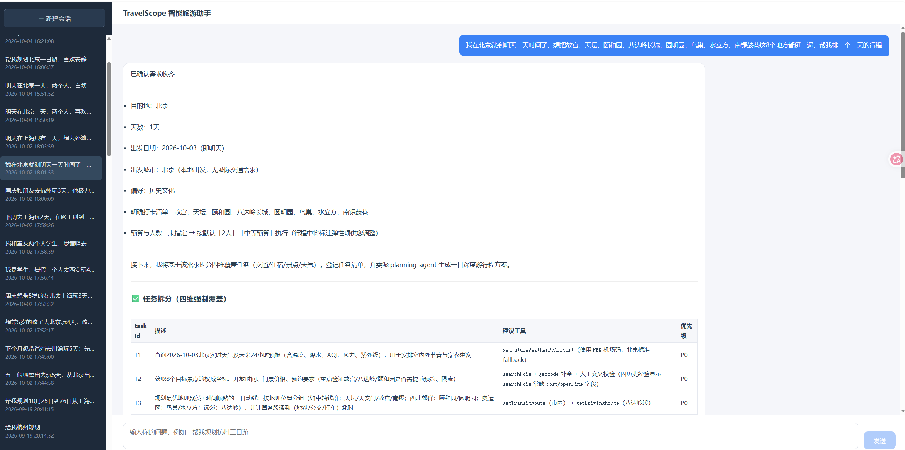
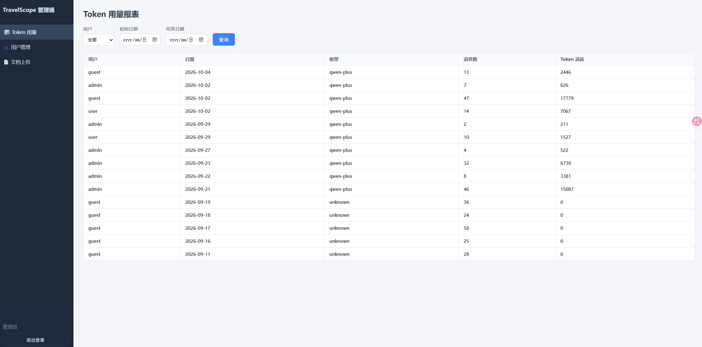
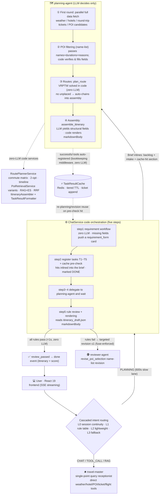

<div align="center">

# 🧭 TravelScope

**An AI multi-agent travel planning system: from a one-sentence request to a ready-to-execute itinerary**

Three agents + code orchestration · JSON-contract-driven · Rule-based review with zero LLM cost · Task-result cache reuse · End-to-end observability

[Java 21](https://img.shields.io/badge/Java-21-orange) · [Spring Boot 3.3](https://img.shields.io/badge/Spring_Boot-3.3.5-brightgreen) · [AgentScope Java 2.0](https://img.shields.io/badge/AgentScope_Java-2.0.3-blue) · [React 19](https://img.shields.io/badge/React-19-61dafb) · [glm-5-3-260814 / deepseek-v4-flash-0731](https://img.shields.io/badge/LLM-glm--5.3%20%2F%20ds--flash-615ced) · [PostgreSQL · Redis · ES](https://img.shields.io/badge/Storage-PG%20%2F%20Redis%20%2F%20ES-336791)

**English** | [简体中文](README.md)

</div>

---

> You say: "**Plan a 2-day Hangzhou + Shanghai trip, budget ¥700, into nature and history**" —
> the orchestration layer collects requirements in code, registers tasks, and pre-checks the cache;
> the planning agent fetches weather, hotels, round-trip train tickets, and the POI candidate pool
> in one parallel first round, finalizes POIs via a name-list tool, then code solves the day-by-day
> routes and assembles the itinerary draft automatically. Rule-based review scores it in under a
> second with zero LLM calls — only a hard failure wakes the reviewer agent for targeted revision —
> and the final itinerary, complete with timeline, budget breakdown, and provenance tags, is
> streamed to your browser.

## 📸 Screenshots

<p align="center">
  
</p>
<p align="center"><b>💬 Chat</b> — SSE streaming conversation: a live activity stream under each bubble shows sub-task progress (searching POIs / checking weather / quality review), clarifying questions arrive as cards, review scores collapse into a details panel, and the final itinerary renders as Markdown tables</p>

<p align="center">
  
</p>
<p align="center"><b>🛠️ Admin</b> — user management · invitation codes · token usage stats · knowledge document upload · evaluation center</p>

**⚡ At a glance**: LLM keeps only **2** irreplaceable jobs across the whole chain (POI preference filtering, draft structural-field generation) · review LLM 258s → rules **<1s** · happy-path end-to-end **131s** (fastest **63.9s** for the same request after optimization) · intent routing serves ~**60%** of traffic at **0** LLM cost · **24** EvalCase dual-track quality gates · **93** test classes

## ✨ Key Features

- 🤖 **Three agents + five-step code orchestration** — `travel-master` (single-point query receptionist, direct tool calls, no delegation) / `planning-agent` (planning execution) / `reviewer-agent` (review fallback); the PLANNING chain is orchestrated by `ChatService` code: requirement collection → task registration + cache pre-check → delegation → rule review + rendering, on a 600s slow lane
- 🧠 **LLM does only two things** — after the planner's parallel first round fetches all data, POI preference filtering (name-list tool) and draft structural-field generation are the only LLM decision points; retrieval, route solving, assembly, review, and bookkeeping are all code (the OpenAI Agents SDK "LLM produces structured JSON → code executes" pattern). A happy path takes only 5~7 LLM calls end to end
- 📜 **JSON-contract-driven collaboration** — six contract files (`intake_result` / `poi_shortlist` / `route_plan` / `itinerary_draft` / `review_report` / `review_passed`) plus the collab five-piece set (9 DTOs + schema validation + atomic writes + TaskWorkspace + TaskRegistry); the tool surface is fenced in: `write_collab_file` is the only persistence gate — `edit_file` / `write_file` / `web_search` / `web_fetch` have been removed from the planner's toolkit
- ✅ **Rule-based review + targeted revision** — `RuleReviewService` checks three rule segments (essentials / timeline consistency / budget & preference + anti-hallucination) in <1s with zero LLM; all-pass delivers directly, a hard failure wakes the reviewer for name-list revision via `revise_poi_selection` (code fills hard fields → re-runs routes → re-assembles), capped at 1 revision by a middleware fuse enforced in code
- 🧭 **Three-tier cascaded intent routing** — L0 session continuity (Redis last-intent + short follow-up detection, zero compute) → L1 rule table (~60% of traffic) → L2 deepseek-v4-flash-0731 lightweight classification (with result caching) → L3 main-chain model fallback; upper layers short-circuit on hit
- 🔍 **Dual-path RAG retrieval** — pgvector semantic search + Elasticsearch BM25 keyword search fused with RRF ranking, evidence gating + query expansion (3~5 variants in parallel); the semantic path degrades to ES full-text automatically when unavailable (`mode=fulltext`)
- ⚡ **Task-result cache** — Redis `taskresult:{userId}:{sessionId}:{taskType}` with TTL tiered by data freshness (weather 10min, POI/hotel/route 30min); **pre-checking hoisted to the orchestration layer**: code checks the cache before delegation and inlines hits into the task brief; successful tool calls are auto-registered by a bookkeeping middleware with zero LLM cost, with append semantics for round-trip tickets to prevent overwrites
- 🛡️ **LLM Gateway** — global concurrency Semaphore(200) → global QPS 100/s → per-user concurrency 2, all via fast-fail `tryAcquire`; the 600s PLANNING slow lane is isolated from the 25s query fast lane; primary/backup models (glm-5-3-260814 → deepseek-v4-flash-0731) with circuit breaking, a first-packet timeout gate, and sticky failback
- 📡 **End-to-end observability** — OpenTelemetry instrumentation (chat-turn / task-cache / review-attempt spans) exported to Jaeger; an SSE protocol that separates process from result (`agent_status` activity stream + a dedicated final-answer event)
- 🧪 **Assessment center** — 24 real-chain EvalCases (multi-city / family / strict budget / nonexistent place / over-dense route and more) combine deterministic rules, model scoring, traces, latency, and token usage; planning cases carry confirmed requirement forms so they do not stop before generation because of missing fields

## 🏗️ Architecture



**Review & revision loop (rules are the first gate; the LLM reviewer only backstops):**

| Rule review result | Action | LLM cost |
|---|---|---|
| PASS / PASS_WITH_WARNINGS (no HARD issues) | Persist `review_passed.json`, deliver SOFT warnings; scores remain for display and evaluation | 0 (<1s) |
| HARD essentials issues (days/destination/origin or multiple unplaced POIs) | Wake the reviewer for targeted revision; the revision brief inlines intake + draft | At most 1 revision |
| HARD timeline, budget, preference, or out-of-shortlist POI issues | Reviewer revises via `revise_poi_selection` (passes only POI names to add/remove; code fills hard fields → re-runs routes → re-assembles) | At most 1 revision |
| Rules re-run after revision | Converged → deliver; otherwise mark DEGRADED and include unresolved issues | At most 1 revision; a second `revise_poi_selection` is fuse-blocked |

**Latency evolution (same "Xi'an 4-day" request, real-chain measurements):**

| Stage | End-to-end | Key change |
|---|---|---|
| v3.2 segment-routed rework baseline | 273~320s | reviewer LLM review 258s; planner hand-wrote the full draft |
| v4 refactor + five optimization cards | 169.5s | reviewer tool re-verification cut to 25.8s; assembly codified to 10.7s; preference hard constraints |
| Rule-based review | 131s | rules pass in <1s, zero reviewer (100/100) |
| Name-list + auto-chained assembly | **63.9s** | planner down to 4 rounds / 28.2s model time (measured on a cache-retained round) |

## 🧠 Engineering Mindset: Key Design Decisions

| Decision | Why |
|---|---|
| **Decisions to the LLM, assembly to code** | Retrieval, route solving, assembly, review, and bookkeeping are all code; the LLM keeps only its two irreplaceable jobs — POI preference filtering and draft structural fields — yielding 5~7 calls per happy path and 63.9s end to end |
| **Contracts as guardrails** | All artifacts persist only through `write_collab_file` / `assemble_itinerary` (schema validation + atomic write); free-form file tools are fenced out of the toolkit — to change the route, the LLM must re-call `plan_route`, never hand-edit contract artifacts |
| **Prompt-driven with code-level backstops** | Agent behavior is constrained by SYS_PROMPT contracts, but key invariants never rely on model discipline: revision caps are middleware-enforced, the name-list tool verifies against the live POI store to prevent hallucination, and assembly failures retry inside the tool instead of burning a whole planner round |
| **Tiered model strategy** | Quality-sensitive review runs on an independently configured reviewer-model (modelResolver routes by sub-agent name), the main chain uses glm-5-3-260814, and L2 intent classification uses deepseek-v4-flash-0731 — layered by task nature for cost and quality |
| **Cascaded intent, not one big LLM** | Intent recognition is a classification problem, not an agent problem: L0 zero compute → L1 rules take ~60% of traffic → L2 lightweight model + Redis caching → L3 fallback; upper layers short-circuit on hit |
| **Designed for failure** | Redis down → task cache/agent state degrade to in-process memory; RAG semantic path down → ES full-text fallback; lane timeout → user-readable degradation copy pushed straight to SSE; assembly LLM failure → one in-tool code retry |
| **Cache economics** | TTLs tiered by freshness; pre-checking hoisted to the orchestration layer (code checks the cache before delegation, inlining hits to save a round); requirement changes (destination/dates) auto-invalidate the session cache, avoiding the "cache stores the failed result" trap |
| **Observability as contract** | Log anchors (`cache_hit=poi` / `review_retry count=N` / `cascade_hit=L0..L3`) double as ops grep points and acceptance-test assertions; OTel spans (chat-turn / task-cache / review-attempt) make every revision traceable |

### 🐛 Measured, not assumed: issues only real-chain runs expose

Every feature ships with environment-gated real-chain acceptance tests. The issues below were all found in real runs, root-caused, and fixed:

| Symptom | Root cause | Fix |
|---|---|---|
| Name-list tool dead-looped | The candidate-pool validation gate hit "thin pools" (the knowledge base is Hangzhou-seeded; target POIs absent), so the model retried endlessly with different names | The gate now verifies existence against the live POI store via searchPois and fills hard fields; the candidate pool is only used for source-tag inheritance |
| Raw cached JSON leaked onto the user's screen | After de-LLM-ing bookkeeping, the cache payload changed from "LLM digests" to "raw tool JSON", and assembly pasted intermediate metadata headers into the draft | A unified `TaskResultFormatter` at the assembly egress strips all metadata headers |
| Return-trip tickets overwrote outbound ones in the cache | The cache stores one value per taskType, so the two registrations clobbered each other | Append + content dedup, so both legs coexist |
| The planner spent 15 rounds on compensating re-checks (135.7s) | De-LLM-ing bookkeeping removed the model's "acknowledgment" signal, so it spontaneously re-read files and re-queried data | Equivalent confirmation restored on the deterministic path (the assembly summary is the check basis + one-line closeout discipline); planner segment 75.1s |

> Lesson: **de-LLM-ing cannot just remove signals — restore an equivalent confirmation on the deterministic path**, or the model will spend more rounds finding it back.

## 🚀 Quick Start

### 1. Requirements

| Dependency | Version | Notes |
|---|---|---|
| JDK | 21+ | |
| Maven | 3.9+ | |
| Node.js | 18+ | frontend build |
| PostgreSQL | 14+ | local install with the [pgvector](https://github.com/pgvector/pgvector) extension |
| Docker | — | orchestrates Redis / MinIO / Elasticsearch |

### 2. Start infrastructure and create the database

```bash
# Redis + MinIO + Elasticsearch (PostgreSQL uses a local instance)
docker-compose up -d

# Create DB + extension + tables
psql -U root -d postgres -c "CREATE DATABASE travelscope;"
psql -U root -d travelscope -c "CREATE EXTENSION IF NOT EXISTS vector;"
psql -U root -d travelscope -f src/main/resources/schema.sql
```

### 3. Configure API keys

```bash
cp .env.example .env   # fill in the keys below
```

| Env var | Description | Where to get it |
|---|---|---|
| `media_model_gateway_api_key` | Model gateway API key (all chat models: glm-5-3-260814 / deepseek-v4-flash-0731; gateway URL in `application.yml` under `travelscope.model-gateway.base-url`) | self-hosted gateway |
| `API_KEY` | Alibaba DashScope API key (Embedding text-embedding-v3 only) | [console.aliyun.com](https://dashscope.console.aliyun.com/apiKey) |
| `AMAP_WEB_API_KEY` | Amap (Gaode) Web API key | [lbs.amap.com](https://lbs.amap.com/) |
| `WEATHER_API_HOST` | QWeather API host (no https:// prefix) | [dev.qweather.com](https://www.qweather.com/en/) |
| `WEATHER_API_KEY` | QWeather API key | [dev.qweather.com](https://www.qweather.com/en/) |
| `FLYAI_API_KEY` | Fliggy flyai CLI key (optional; the Fliggy source for hotels/POIs/train tickets; empty runs the CLI in keyless trial mode) | Fliggy open platform |

### 4. Start backend and frontend

On Windows, start the backend (port 8080) from the project root with one command:

```powershell
npm run dev
```

The command goes through the root `package.json` to `dev.cmd` — no `npm install` needed at the root. It first runs the Maven package step (tests skipped), then starts the backend; it stops if packaging fails. Requires Node.js/npm, Java 21, and Maven on `PATH`; press `Ctrl+C` to stop. Every run re-packages, so the same command applies after code or config changes. Run `npm run dev` inside `frontend/` to start the frontend instead.

Or manually:

```bash
# Backend (port 8080) — java -jar recommended (boot jar has the full classpath)
mvn package -DskipTests
java -jar target/TravelScope-1.0-SNAPSHOT.jar

# Alternative: mvn spring-boot:run (some Maven distributions fork a classpath that misses
# agentscope dependencies and throws ClassNotFoundException — use java -jar above if so)

# Frontend (new terminal, port 3000, /api proxied to 8080)
cd frontend && npm install && npm run dev
```

Open `http://localhost:3000` to start chatting. Health check: `http://localhost:8080/api/actuator/health`.

After signing in as admin, visit `http://localhost:3000/admin/assessment` for the evaluation center. First-time setup requires running `src/main/resources/assessment-upgrade.sql`; collection and batch toggles live under `travelscope.assessment`.

> Accounts: schema.sql seeds an admin `admin / admin123`; **new users currently register by invitation code only** (codes are issued by admins on the 🎫 Invitation Codes page). Chats deduct points by intent (normal chat 50 / trip planning 200); **every new user gets 500 initial points on registration**, and admins can adjust balances inline on the 👥 Users page.

## 🧪 Tests & Quality Gates

```bash
# Unit / contract tests (no external APIs needed, 93 test classes)
mvn test

# Real-chain acceptance tests (requires export media_model_gateway_api_key=...)
mvn test -Dtest=ReviewerSegmentedReviewRealApiTest   # reviewer segmented review contract
mvn test -Dtest=RoutePlannerRealApiTest              # VRPTW route solving, real chain
mvn test -Dtest=IntentCascadeRealApiTest             # cascaded intent routing
mvn test -Dtest=LlmGatewayRealApiTest                # gateway primary/backup & circuit breaking

# Assessment-center backend regression (create real batches in the admin Assessment Center)
mvn "-Dtest=Assessment*Test,EvalCaseLoaderTest" test
```

The EvalCase suite lives in `src/main/resources/evalcases/` (EC-001~024), covering 12 scenario categories. Every planning case carries a confirmed requirement form; if natural-language extraction still leaves required fields empty, the assessment runner submits that form before continuing. The missing-information case intentionally remains at the input step.

## 📁 Project Structure

```
TravelScope/
├── pom.xml                          # Java 21 + Spring Boot 3.3.5 + AgentScope 2.0.3
├── docker-compose.yml               # Redis 7 + MinIO + Elasticsearch
├── dev.cmd                          # Windows one-command packaging & startup (npm run dev)
├── frontend/                        # React 19 + Vite + TS (login / chat / admin)
└── src/
    ├── main/java/com/travelscope/
    │   ├── agent/                   # three agents + middleware + gateway model
    │   │   ├── TravelMasterAgent.java       # travel-master: single-point query receptionist
    │   │   ├── ItineraryAgent.java          # planning-agent: five-step SYS_PROMPT
    │   │   ├── ReviewerAgent.java           # reviewer-agent: targeted revision
    │   │   ├── IntentCascadeRouter.java     # intent L0~L3 cascade
    │   │   ├── ReviewerRetryMiddleware.java # revision fuse (≤1, code-enforced)
    │   │   ├── BookkeepingMiddleware.java   # zero-LLM bookkeeping (tool events → cache + task status)
    │   │   ├── LlmGatewayModel.java         # primary/backup + circuit breaking + first-packet gate
    │   │   └── tools/                       # @Tool surface (weather/hotel/POI/ticket/flight/RAG/collab files)
    │   ├── collab/                  # workspace JSON contract five-piece set (9 DTOs + schema + atomic writes)
    │   ├── service/                 # ChatService five-step orchestration / LlmGateway / TaskResultCache /
    │   │   │                        # RuleReviewService / ItineraryAssembler /
    │   │   │                        # TaskResultFormatter / dual-path RAG…
    │   │   ├── route/               # VRPTW solving (commute matrix / day split / 2-opt / timeline)
    │   │   ├── retrieval/           # POI retrieval (query variants / dual path / RRF)
    │   │   └── workflow/            # requirement state machine + task backlog planning
    │   ├── eval/                    # EvalCase dual-track scoring
    │   ├── assessment/              # evaluation collection & batches
    │   └── controller/  repository/  entity/  dto/  config/  security/  common/
    └── test/java/com/travelscope/   # 93 test classes (incl. 4 real-chain gated tests)
```

## 📊 Observability

- **Tracing**: Micrometer + OpenTelemetry → Jaeger; business spans: `chat-turn` (whole turn), `task-cache` (cache hit), `review-attempt` (review count + verdict + score), `task-backlog`, etc.
- **Log anchors** (greppable / assertable): `cache_hit={taskType}`, `cache_miss`, `review_retry count=N`, `cascade_hit=L0|L1|L2|L3`, `task_result_registered`
- **SSE event protocol**: `intent` (verdict) → `delta` (streaming body) → `agent_status` (agent activity stream, rendered live under bubbles) → `requirement_form` (requirement form card) → `clarify_question` (follow-up question) → `review_report` (score details, collapsed) → `done` / `error`

## 🗺️ Roadmap

- [ ] **v5 resilience** (plan finalized in [docs/TravelScope改造计划-v5.md](docs/TravelScope改造计划-v5.md), Chinese): F1 reconnect (turnId idempotency + decoupling execution from SSE) · F2 Fliggy image passthrough · F3 multi-model circuit-breaker pool (CHAT 4+1 / EMBEDDING 2) · F4 chat-side zh/en switching · F5 photo-based AI guide
- [ ] **v6 rework chain & production hardening** ([docs/TravelScope改造计划-v6.md](docs/TravelScope改造计划-v6.md), Chinese): HARD/SOFT review grading · incremental re-assembly · round merging & context slimming · day-by-day streaming output
- [ ] Replace L2 lightweight classification with intent-example vector similarity (pgvector cosine top-1)

## 🧭 Code Navigation

| Want to understand | Look at |
|---|---|
| PLANNING five-step orchestration | `src/main/java/com/travelscope/service/ChatService.java` |
| Planner five steps & tool discipline | `src/main/java/com/travelscope/agent/ItineraryAgent.java` (SYS_PROMPT) |
| Rule review, three segments | `src/main/java/com/travelscope/service/RuleReviewService.java` |
| Workspace JSON contracts | `src/main/java/com/travelscope/collab/` (PoiShortlist / RoutePlan / ItineraryDraft / …) |
| VRPTW route solving | `src/main/java/com/travelscope/service/route/RoutePlannerServiceImpl.java` |
| Dual-path POI retrieval | `src/main/java/com/travelscope/service/retrieval/PoiRetrievalService.java` |
| Cascaded intent routing | `src/main/java/com/travelscope/agent/IntentCascadeRouter.java` |
| Bookkeeping middleware (zero LLM) | `src/main/java/com/travelscope/agent/BookkeepingMiddleware.java` |
| Task-result cache | `src/main/java/com/travelscope/service/TaskResultCache.java` |
| LLM gateway (limits / circuit / lanes) | `src/main/java/com/travelscope/service/LlmGateway.java` + `agent/LlmGatewayModel.java` |
| Revision fuse | `src/main/java/com/travelscope/agent/ReviewerRetryMiddleware.java` |
| Planning-chain flow diagrams | `docs/PLANNING链路流程图.md` |
| Real-chain acceptance tests (gated) | `src/test/java/com/travelscope/agent/` (*RealApiTest) |
| EvalCase dual-track quality gate | `src/main/java/com/travelscope/eval/` + `src/main/resources/evalcases/` |

---

<div align="center">

**TravelScope** — personal learning / portfolio project, code for learning and exchange only

If this project helps you, a ⭐ Star is appreciated

</div>
