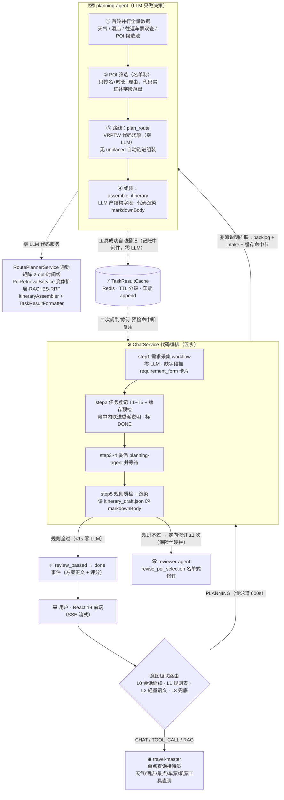

<div align="center">

# 🧭 TravelScope

**从一句话需求到可执行行程单的 AI 多智能体旅行规划系统**

三 Agent + 代码编排 · JSON 契约驱动 · 规则质检零 LLM · 任务结果缓存复用 · 全链路可观测

[Java 21](https://img.shields.io/badge/Java-21-orange) · [Spring Boot 3.3](https://img.shields.io/badge/Spring_Boot-3.3.5-brightgreen) · [AgentScope Java 2.0](https://img.shields.io/badge/AgentScope_Java-2.0.3-blue) · [React 19](https://img.shields.io/badge/React-19-61dafb) · [glm-5-3-260814 / deepseek-v4-flash-0731](https://img.shields.io/badge/LLM-glm--5.3%20%2F%20ds--flash-615ced) · [PostgreSQL · Redis · ES](https://img.shields.io/badge/Storage-PG%20%2F%20Redis%20%2F%20ES-336791)

**简体中文** | [English](README.en.md)

</div>

---

> 你说「**帮我规划杭州加上海双城 2 日游，预算 700，喜欢自然和人文**」——
> 编排层代码采集需求、登记任务并预检缓存；规划 Agent 首轮一次并行抓齐天气、酒店、往返车票与景点候选池，
> 名单制定案 POI、代码求解分日路线并自动组装行程草案；
> 规则质检 <1 秒全过即零 LLM 送审，发现硬伤才唤起质检 Agent 定向修订——
> 最后把一份带时间线、预算汇总与来源标注的行程单流式推到你的浏览器。

## 📸 界面预览

<p align="center">
  
</p>
<p align="center"><b>💬 对话端</b> —— SSE 流式对话：气泡下方的活动流实时展示子任务进展（检索景点 / 查询天气 / 质量审核），需求反问以卡片弹出，质检评分明细折叠展示，最终行程方案以 Markdown 表格渲染</p>

<p align="center">
  
</p>
<p align="center"><b>🛠️ 管理员端</b> —— 用户管理 · 邀请码 · Token 用量 · 知识文档上传 · 评估中心</p>

**⚡ 数据速览**：LLM 全链只保留 **2** 件不可替代的事（POI 偏好筛选决策、草案结构字段产出）· 质检 LLM 258s → 规则 **<1s** · happy path 端到端 **131s**（同需求优化后最快 **63.9s**）· 意图路由约 **60%** 流量 0 LLM 成本 · **24** 条 EvalCase 双轨质量门禁 · **93** 个测试类

## ✨ 核心特性

- 🤖 **三 Agent + 代码五步编排** — `travel-master`（单点查询接待员，工具直调零委派）/ `planning-agent`（规划执行）/ `reviewer-agent`（质检兜底）；PLANNING 链路由 `ChatService` 代码编排：需求采集 → 任务登记 + 缓存预检 → 委派规划 → 规则质检 + 渲染，慢泳道 600s
- 🧠 **LLM 只做两件事** — planner 首轮并行抓齐全量数据后，POI 偏好筛选（名单制工具）与草案结构字段产出是仅有的 LLM 决策点；检索、路线求解、组装、质检、记账全部代码化（OpenAI Agents SDK「LLM 产结构化 JSON → 代码执行」模式），happy path 全链仅 5~7 次 LLM 调用
- 📜 **JSON 契约驱动协作** — 六个契约文件（`intake_result` / `poi_shortlist` / `route_plan` / `itinerary_draft` / `review_report` / `review_passed`）+ collab 五件套（9 个 DTO + Schema 校验 + 原子写 + TaskWorkspace + TaskRegistry）；工具面收编：`write_collab_file` 是唯一落盘口，`edit_file` / `write_file` / `web_search` / `web_fetch` 已从 planner 工具面移除
- ✅ **规则质检 + 定向修订** — `RuleReviewService` 三段规则（基本要素 / 时间线自洽 / 预算偏好 + 防幻觉）零 LLM <1s 出分；全过直接交付，发现硬伤才唤起 reviewer 用 `revise_poi_selection` 名单式修订（代码补硬字段 → 重跑路线 → 重组装），修订上限 1 次由中间件保险丝代码硬拦
- 🧭 **意图三层级联路由** — L0 会话延续（Redis 最近意图 + 短追问识别，0 计算）→ L1 规则表（承接约 60% 流量）→ L2 deepseek-v4-flash-0731 轻量语义分类（带结果缓存）→ L3 主链路模型兜底，上层命中即短路
- 🔍 **RAG 双路检索** — pgvector 语义检索 + Elasticsearch BM25 关键词检索，RRF 融合排序，证据门控 + 变体扩展（3~5 个查询变体并行）；向量路不可用时自动退化为 ES 全文（`mode=fulltext`）
- ⚡ **任务结果缓存** — Redis `taskresult:{userId}:{sessionId}:{taskType}`，TTL 按数据时效分级（天气 10min、POI/酒店/路线 30min）；**预检上提到编排层**：委派前代码查缓存，命中内容直接内联进委派说明；工具成功由记账中间件零 LLM 自动登记，往返车票 append 防互覆
- 🛡️ **LLM Gateway** — 全局并发 Semaphore(200) → 全局 QPS 100/s → 单用户并发 2，全 `tryAcquire` 快速失败；PLANNING 慢泳道 600s 与查询快泳道 25s 隔离；主备模型（glm-5-3-260814 → deepseek-v4-flash-0731）+ 熔断 + 首包超时闸门 + 粘滞回切
- 📡 **全链路可观测** — OpenTelemetry 埋点（chat-turn / task-cache / review-attempt 等 span）对接 Jaeger；SSE 过程/结果分离事件协议（`agent_status` 活动流 + 最终方案独立事件）
- 🧪 **评估中心** — 24 条 EvalCase 真实链路用例（多城市/亲子/严格预算/地点不存在/路线过密等），统一展示确定性规则、模型评分、调用链、耗时与 Token；普通规划用例带已确认需求表单，避免在生成前因缺项终止

## 🏗️ 系统架构



**质检与修订闭环（规则质检为第一道门，LLM reviewer 只兜底）：**

| 规则质检结果 | 动作 | LLM 成本 |
|---|---|---|
| PASS / PASS_WITH_WARNINGS（无 HARD 问题） | `review_passed.json` 落盘，软问题随 warnings 交付；评分用于展示与评估 | 0（<1s） |
| 段 1 存在 HARD 问题（天数/目的地/出发地或多个 POI 未排入） | 唤起 reviewer 定向修订，修订任务内联 intake + 草案 | 最多 1 次修订 |
| 时间线重叠、严重预算偏差、偏好全未覆盖或候选池外 POI 等 HARD 问题 | reviewer 用 `revise_poi_selection` 名单式修订（只传加/删 POI 名，代码补硬字段 → 重跑路线 → 重组装） | 最多 1 次修订 |
| 修订后重跑规则质检 | 收敛即交付；仍有硬伤则标记 DEGRADED，附未解决问题交付 | 最多 1 次修订，第 2 次 `revise_poi_selection` 被保险丝拦截 |

**耗时演进（同需求「西安四日」真实链路实测）：**

| 阶段 | 端到端 | 关键变化 |
|---|---|---|
| v3.2 分段回炉基线 | 273~320s | reviewer LLM 质检 258s、planner 手写整篇草案 |
| v4 重构 + 五卡优化 | 169.5s | reviewer 砍工具重算 25.8s、组装代码化 10.7s、偏好硬约束 |
| 质检规则化 | 131s | 规则 <1s 全过零 reviewer（100/100 分） |
| 名单制 + 自动链组装 | **63.9s** | planner 仅 4 轮 / 模型耗时 28.2s（缓存保留轮实测） |

## 🧠 工程思维：关键设计与取舍

| 设计决策 | 为什么这么选 |
|---|---|
| **决策给 LLM、组装给代码** | 检索、路线求解、组装、质检、记账全部代码化；LLM 只保留 POI 偏好筛选与草案结构字段产出两件不可替代的事——happy path 5~7 次调用，全链 63.9s 起步 |
| **契约即护栏** | 全部产物只经 `write_collab_file` / `assemble_itinerary` 落盘（Schema 校验 + 原子写）；`edit_file` 等自由文件工具从工具面收编——LLM 想改路线只能重调 `plan_route`，杜绝手改契约产物 |
| **提示词驱动 + 代码层兜底** | Agent 行为靠 SYS_PROMPT 契约约束，但关键不变量绝不依赖模型自觉：回炉次数中间件硬拦、名单制代码实证防幻觉、组装失败代码内重试不惊动 planner 整轮 |
| **分级模型策略** | 质量敏感的质检走独立配置的 reviewer-model（modelResolver 按子 Agent 名分流）、主链路 glm-5-3-260814、L2 意图分类 deepseek-v4-flash-0731——按任务性质分层，成本与质量兼得 |
| **意图级联而非一锅 LLM** | 意图识别是分类问题不是 Agent 问题：L0 会话延续 0 计算 → L1 规则表承接约 60% 流量 → L2 轻量模型 + Redis 结果缓存 → L3 兜底，上层命中即短路 |
| **面向失败设计** | Redis 挂 → 任务缓存/Agent 状态自动降级进程内存；RAG 向量路不可用 → 退化为 ES 全文；泳道超时 → 用户可读降级文案直推 SSE；组装 LLM 产字段失败 → 代码内重试 1 次 |
| **缓存与成本联动** | TTL 按数据时效分级；预检上提到编排层（委派前代码查缓存，命中内联进任务说明省一轮）；需求变更（目的地/日期）自动全清会话缓存，防「缓存里存的就是失败结果」的复用陷阱 |
| **可观测即契约** | 日志锚点（`cache_hit=poi` / `review_retry count=N` / `cascade_hit=L0..L3`）同时是运维 grep 点和验收测试断言点；OTel span（chat-turn / task-cache / review-attempt）让每一次修订可追溯 |

### 🐛 实测驱动：真跑暴露的问题（单测发现不了）

每个特性都配环境变量门控的真实链路验收测试。以下问题全部由真实链路跑出、定位根因后修复：

| 现象 | 根因 | 修复 |
|---|---|---|
| 名单制工具死循环 | 候选池校验硬门遇到「池薄」（知识库种子偏杭州，池内无目标 POI），模型反复换名重试 | 硬门改为 searchPois 实时 POI 库实证存在 + 补硬字段，候选池仅作 source 标记继承 |
| 缓存原文 JSON 直通用户屏幕 | 记账去 LLM 化后，缓存承载物从「LLM 摘要」变「工具原文 JSON」，组装把中间元信息头行一并拼进草案 | 组装出口统一 `TaskResultFormatter` 格式化，剥离全部元信息头行 |
| 返程车票缓存覆盖去程 | 缓存按 taskType 单键存储，往返两次登记互相覆盖 | append 拼接 + 内容去重，往返双段共存 |
| planner 15 轮补偿性复查（135.7s） | 记账去 LLM 化删掉了模型的「汇报确认」信号，模型自发 read_file 复查草案 + 补查数据 | 确定性通道补回等价确认（组装返回摘要即核对依据 + 一行收尾纪律），planner 段 75.1s |

> 教训：**去 LLM 化不能只删信号，要在确定性通道补回等价确认**——否则模型会用更多轮次自己找回来。

## 🚀 快速开始

### 1. 环境要求

| 依赖 | 版本 | 说明 |
|---|---|---|
| JDK | 21+ | |
| Maven | 3.9+ | |
| Node.js | 18+ | 前端构建 |
| PostgreSQL | 14+ | 本地安装，含 [pgvector](https://github.com/pgvector/pgvector) 扩展 |
| Docker | — | 编排 Redis / MinIO / Elasticsearch |

### 2. 启动基础设施与建库

```bash
# Redis + MinIO + Elasticsearch（PostgreSQL 使用本地实例）
docker-compose up -d

# 建库 + 扩展 + 建表
psql -U root -d postgres -c "CREATE DATABASE travelscope;"
psql -U root -d travelscope -c "CREATE EXTENSION IF NOT EXISTS vector;"
psql -U root -d travelscope -f src/main/resources/schema.sql
```

### 3. 配置 API Key

```bash
cp .env.example .env   # 填入下列 Key
```

| 环境变量 | 说明 | 获取地址 |
|---|---|---|
| `media_model_gateway_api_key` | 模型网关 API Key（全部对话模型：glm-5-3-260814 / deepseek-v4-flash-0731，网关地址见 `application.yml` 的 `travelscope.model-gateway.base-url`） | 自建网关 |
| `API_KEY` | 通义千问 DashScope API Key（仅 Embedding text-embedding-v3 使用） | [console.aliyun.com](https://dashscope.console.aliyun.com/apiKey) |
| `AMAP_WEB_API_KEY` | 高德地图 Web API Key | [lbs.amap.com](https://lbs.amap.com/) |
| `WEATHER_API_HOST` | 和风天气 API Host（不含 https://） | [dev.qweather.com](https://dev.qweather.com/) |
| `WEATHER_API_KEY` | 和风天气 API Key | [dev.qweather.com](https://dev.qweather.com/) |
| `FLYAI_API_KEY` | 飞猪 flyai CLI Key（可选，酒店/景点/火车票飞猪源；留空走免 key 体验模式） | 飞猪开放平台 |

### 4. 启动后端与前端

Windows 下，在项目根目录用一条命令启动后端（默认 8080）：

```powershell
npm run dev
```

该命令通过根目录的 `package.json` 调用 `dev.cmd`，无需在根目录执行 `npm install`。脚本会先执行 Maven 打包（跳过测试），成功后启动后端；打包失败时停止。需要 Node.js/npm、Java 21 和 Maven 已加入 `PATH`，按 `Ctrl+C` 停止后端。每次执行都会重新打包，代码和配置修改后也使用同一条命令。在 `frontend` 目录执行 `npm run dev` 则启动前端。

也可以手动执行以下命令：

```bash
# 后端（默认 8080）——推荐 java -jar（Boot jar 依赖完整）
mvn package -DskipTests
java -jar target/TravelScope-1.0-SNAPSHOT.jar

# 备选：mvn spring-boot:run（部分 Maven 发行版下 run 目标 fork 的类路径会缺失
# agentscope 依赖报 ClassNotFoundException，遇到时用上面的 java -jar 方式）

# 前端（另开终端，默认 3000，已配置 /api → 8080 代理）
cd frontend && npm install && npm run dev
```

访问 `http://localhost:3000` 开始对话。健康检查：`http://localhost:8080/api/actuator/health`。

管理员登录后，可访问 `http://localhost:3000/admin/assessment` 使用评估中心。首次启用前需执行 `src/main/resources/assessment-upgrade.sql`，采集与批次开关位于 `travelscope.assessment`。详细的本地说明见 `docs/评估系统说明.md`（不入库）。

> 账号体系：schema.sql 内置管理员种子 `admin / admin123`；**现阶段新用户仅凭邀请码注册**
> （登录页「凭邀请码注册」入口，邀请码由管理员在管理端「🎫 邀请码」页发放），后续可能
> 开放注册接口。
> 对话按意图扣积分（普通对话 50 / 行程规划 200）；**所有新用户注册即送 500 初始积分**
> （与是否用邀请码无关——送 500 是注册行为本身的属性），余额不足时由管理员在
> 「👥 用户管理」页行内调整。

## 🧪 测试与质量门禁

```bash
# 单元 / 契约测试（无需外部 API，93 个测试类）
mvn test

# 真实链路验收测试（需 export media_model_gateway_api_key=...）
mvn test -Dtest=ReviewerSegmentedReviewRealApiTest   # reviewer 分段审核契约
mvn test -Dtest=RoutePlannerRealApiTest              # VRPTW 路线求解真实链路
mvn test -Dtest=IntentCascadeRealApiTest             # 意图级联路由
mvn test -Dtest=LlmGatewayRealApiTest                # 网关主备与熔断

# 评估中心后端回归（真实批次请在管理端“评估中心”创建）
mvn "-Dtest=Assessment*Test,EvalCaseLoaderTest" test
```

EvalCase 用例库在 `src/main/resources/evalcases/`，随 JAR 打包，共 24 条、覆盖 12 类场景。EC-001～EC-020 保留评估模块的场景；主线原 EC-011/012 回炉恢复场景迁为 EC-021/022，原 EC-013/014 预算边缘场景迁为 EC-023/024。编号调整不改写已冻结的历史批次及其用例正文。

评测与日常规划共用需求工作流、任务登记、路线规划及审核流程。除信息缺失场景外，每条 EvalCase 都携带已确认的需求表单；自然语言抽取未收齐必填项时，runner 会自动模拟表单提交，再进入规划。JSON 契约 `itinerary_draft.json` 优先，文本评分使用其中的 `markdownBody`；仅本轮成功写入并明确关联的产物可以作为最终行程，保留旧 Markdown 兼容。FIXTURE 只替换外部数据源，继续执行本地检索编排、路线算法和契约校验；工具顺序缺少真实事件证据时标记无法判断。

## 📁 项目结构

```
TravelScope/
├── pom.xml                          # Java 21 + Spring Boot 3.3.5 + AgentScope 2.0.3
├── docker-compose.yml               # Redis 7 + MinIO + Elasticsearch 编排
├── dev.cmd                          # Windows 一键打包启动（npm run dev）
├── frontend/                        # React 19 + Vite + TS（登录 / 聊天 / 管理端）
└── src/
    ├── main/java/com/travelscope/
    │   ├── agent/                   # 三 Agent + 中间件 + 网关模型
    │   │   ├── TravelMasterAgent.java       # travel-master：单点查询接待员
    │   │   ├── ItineraryAgent.java          # planning-agent：五步规划 SYS_PROMPT
    │   │   ├── ReviewerAgent.java           # reviewer-agent：定向修订
    │   │   ├── IntentCascadeRouter.java     # 意图 L0~L3 级联
    │   │   ├── ReviewerRetryMiddleware.java # 回炉保险丝（≤1 次代码硬拦）
    │   │   ├── BookkeepingMiddleware.java   # 记账零 LLM（工具事件→缓存+任务状态）
    │   │   ├── LlmGatewayModel.java         # 主备 + 熔断 + 首包闸门
    │   │   └── tools/                       # @Tool 工具面（天气/酒店/景点/车票/机票/RAG/协作文件）
    │   ├── collab/                  # 工作区 JSON 契约五件套（9 DTO + Schema 校验 + 原子写）
    │   ├── service/                 # ChatService 五步编排 / LlmGateway / TaskResultCache /
    │   │   │                        # RuleReviewService 规则质检 / ItineraryAssembler /
    │   │   │                        # TaskResultFormatter / RAG 双路…
    │   │   ├── route/               # VRPTW 求解（通勤矩阵 / 分日 / 2-opt / 时间线）
    │   │   ├── retrieval/           # POI 检索（变体扩展 / 双路 / RRF）
    │   │   └── workflow/            # 需求采集状态机 + 任务清单规划
    │   ├── eval/                    # EvalCase 双轨评分
    │   ├── assessment/              # 评估采集与批次
    │   └── controller/  repository/  entity/  dto/  config/  security/  common/
    └── test/java/com/travelscope/   # 93 个测试类（含 4 个真实链路门控测试）
```

## 📊 可观测性

- **Tracing**：Micrometer + OpenTelemetry → Jaeger；业务 span：`chat-turn`（整轮）、`task-cache`（缓存命中）、`review-attempt`（送审计数 + 结论 + 分数）、`task-backlog` 等
- **日志锚点**（可 grep / 可断言）：`cache_hit={taskType}`、`cache_miss`、`review_retry count=N`、`cascade_hit=L0|L1|L2|L3`、`task_result_registered`
- **SSE 事件协议**：`intent`（意图结论）→ `delta`（流式正文）→ `agent_status`（Agent 活动流，前端气泡下方实时渲染）→ `requirement_form`（需求补全卡片）→ `clarify_question`（反问）→ `review_report`（质检评分明细折叠区）→ `done` / `error`

## 🗺️ Roadmap

- [ ] **v5 韧性增强**（方案已定稿 [docs/TravelScope改造计划-v5.md](docs/TravelScope改造计划-v5.md)）：F1 断线重连（turnId 幂等 + 执行与 SSE 解耦）· F2 飞猪图片透传 · F3 多模型熔断池（CHAT 4+1 / EMBEDDING 2）· F4 用户端中英切换 · F5 拍照识景讲解员
- [ ] **v6 回炉链路与生产化**（[docs/TravelScope改造计划-v6.md](docs/TravelScope改造计划-v6.md)）：质检 HARD/SOFT 分级 · 增量重组装 · 轮次合并与上下文瘦身 · 流式逐天输出
- [ ] 意图例句向量相似度（pgvector 余弦 top1）替换 L2 轻量分类

## 🧭 核心代码导航

| 想了解 | 看这里 |
|---|---|
| PLANNING 五步编排 | `src/main/java/com/travelscope/service/ChatService.java` |
| planner 五步与工具纪律 | `src/main/java/com/travelscope/agent/ItineraryAgent.java`（SYS_PROMPT） |
| 规则质检三段规则 | `src/main/java/com/travelscope/service/RuleReviewService.java` |
| 工作区 JSON 契约 | `src/main/java/com/travelscope/collab/`（PoiShortlist / RoutePlan / ItineraryDraft / …） |
| VRPTW 路线求解 | `src/main/java/com/travelscope/service/route/RoutePlannerServiceImpl.java` |
| POI 双路检索 | `src/main/java/com/travelscope/service/retrieval/PoiRetrievalService.java` |
| 意图级联路由 | `src/main/java/com/travelscope/agent/IntentCascadeRouter.java` |
| 记账中间件（零 LLM） | `src/main/java/com/travelscope/agent/BookkeepingMiddleware.java` |
| 任务结果缓存 | `src/main/java/com/travelscope/service/TaskResultCache.java` |
| LLM 网关（限流/熔断/泳道） | `src/main/java/com/travelscope/service/LlmGateway.java` + `agent/LlmGatewayModel.java` |
| 回炉保险丝 | `src/main/java/com/travelscope/agent/ReviewerRetryMiddleware.java` |
| 规划链路流程图（时序+文件流转） | `docs/PLANNING链路流程图.md` |
| 真实链路验收测试（门控） | `src/test/java/com/travelscope/agent/`（*RealApiTest） |
| EvalCase 双轨质量门禁 | `src/main/java/com/travelscope/eval/` + `src/main/resources/evalcases/` |

---

<div align="center">

**TravelScope** — 个人学习 / 作品集项目，代码仅供学习交流

如果这个项目对你有帮助，欢迎点一个 ⭐ Star

</div>
